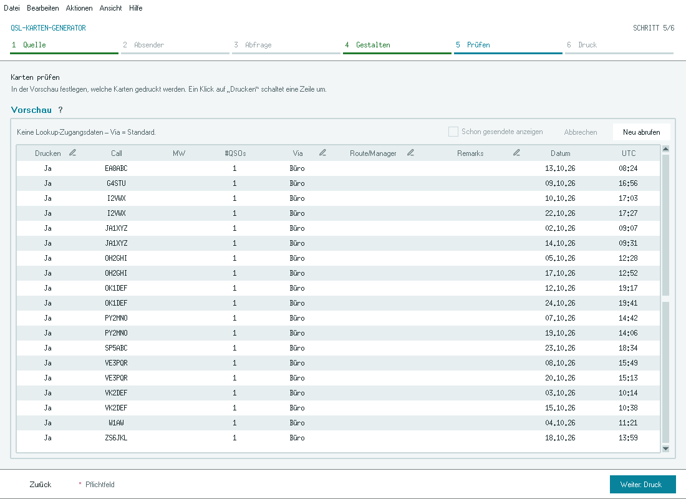
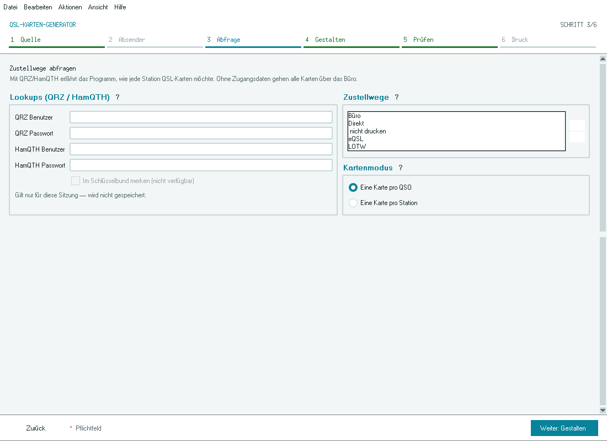
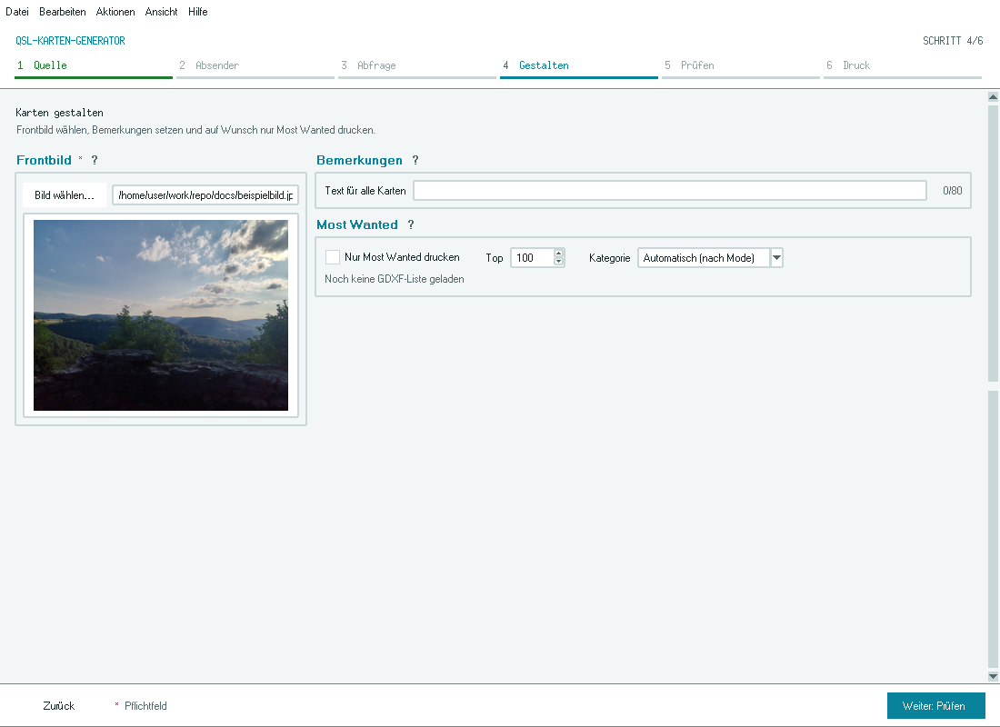
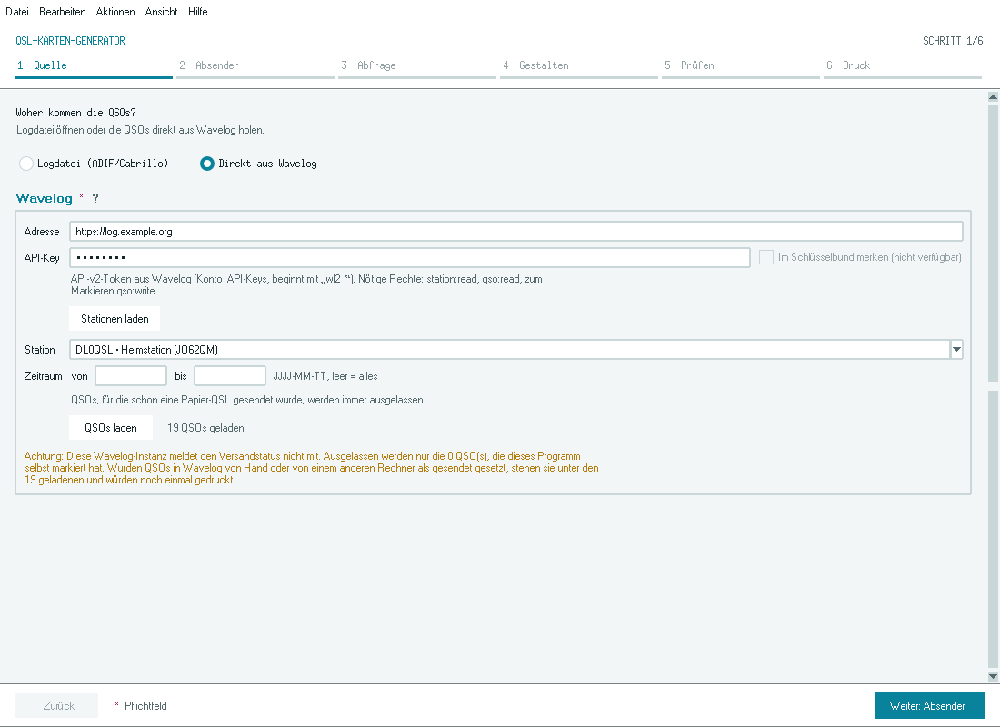
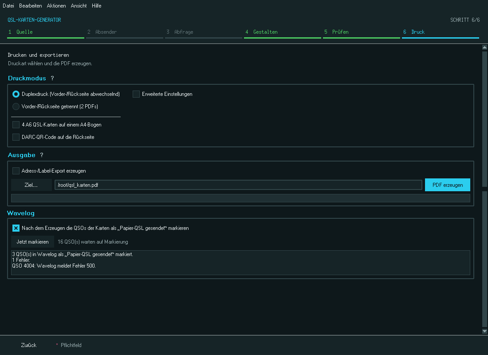

# QSL-Karten-Generator

Erzeugt aus einem Logbuch eine PDF mit QSL-Karten. Jede Karte besteht aus
zwei A6-Seiten: einer Bild-Vorderseite (ein Bild für alle Karten) und einer
Rückseite im DARC-QSL-Layout. Die QSOs kommen aus einer **ADIF- oder
Cabrillo-Datei** oder **direkt aus Wavelog**; nach dem Druck markiert das
Programm die Karten dort auf Wunsch als „Papier-QSL gesendet".

Python + Tkinter, läuft unter Linux, Windows und macOS. Lizenz: **GPLv3**
(siehe [`LICENSE`](LICENSE)).



## Inhalt

- [Features](#features)
- [Installation](#installation)
- [Bedienung: der Assistent in sechs Schritten](#bedienung-der-assistent-in-sechs-schritten)
- [Wavelog-Anbindung](#wavelog-anbindung)
- [Lookups: QRZ und HamQTH](#lookups-qrz-und-hamqth)
- [Entwickeln](#entwickeln)
- [Bauen (auslieferbare Anwendung)](#bauen-auslieferbare-anwendung)
- [Dokumentation](#dokumentation)
- [Hinweise](#hinweise)
- [Lizenz](#lizenz)

## Features

- **Geführter Assistent** mit sechs Schritten — Quelle, Absender, Abfrage,
  Gestalten, Prüfen, Druck. Es ist immer nur ein Schritt zu sehen; „Weiter"
  sagt, was noch fehlt.
- **Drei Quellen, ein Datenmodell**: ADIF (`.adi`, `.adif`), **Cabrillo**
  (`.cbr`, `.log`) aus dem Contest — das Format wird am Inhalt erkannt, nicht an
  der Endung, eigene Parser ohne Fremd-Package — oder **Wavelog über die API v2**.
- **Schon gesendete QSLs bekommen keine Karte** (`QSL_SENT = Y`, auch bei
  ADIF-Dateien; bei Wavelog zusätzlich die selbst markierten QSOs). Ein bewusster
  Nachdruck geht über „Schon gesendete anzeigen" in der Vorschau.
- **Rückseite exakt nach Referenz-Layout** (`docs/CARD_LAYOUT.md`). Zu lange
  Werte (Name, Antennenbezeichnung, Rufzeichen mit Präfix) werden **kleiner
  gesetzt, nie abgeschnitten**.
- **Absenderdaten aus der Config** (im Programm eingetragen, nie aus dem Log);
  QSO-Daten (Datum, UTC, Frequenz, Mode, Rapport) aus dem Log.
- **Versandart (Via) je Station automatisch per Lookup** (QRZ/HamQTH): **B**
  Büro (inkl. Manager), **D** Direkt, **Q** eQSL, **L** LoTW. Die Wege werden
  priorisiert, eine **Trennlinie** legt fest, welche gedruckt werden.
- Eine Karte **pro QSO** oder **pro Station**.
- Druck als **Duplex** (eine PDF) oder **getrennt** (zwei PDFs), wahlweise
  **vier Karten auf einem A4-Bogen** mit Schnitt-Hilfslinien; einstellbarer
  Druckrand je Kante.
- **DARC-QR-Code** (optional): rechts unten auf der Rückseite, 20 × 20 mm, mit
  Absender, Manager, Empfänger und den QSOs im Format von
  [DM2PF/QSL_QR_Label](https://github.com/DM2PF/QSL_QR_Label). Dann höchstens
  drei QSOs je Karte.
- **Most-Wanted-Filter**: auf Wunsch nur Karten an die gesuchtesten
  DXCC-Gebiete der **GDXF-Liste** ([gdxf.de/mostwanted](https://gdxf.de/mostwanted/))
  — Top N, je Mode oder Mixed. Das Gebiet kommt aus dem ADIF-Feld `DXCC`, sonst
  aus der mitgelieferten `cty.dat` von AD1C — damit auch für Cabrillo und ohne
  Lookup.
- **Adress-/Label-Export** (CSV) für genau die gedruckten Karten.
- **Zugangsdaten nie im Klartext auf der Platte**: Wavelog-Key und QRZ/HamQTH
  gelten nur für die Sitzung oder liegen auf Wunsch im **Schlüsselbund** des
  Systems. Passwörter und Tokens werden aus Protokoll und Fehlermeldungen
  herausmaskiert.
- **Harmonisches Farbschema** in Hell und Dunkel, aus einer Grundfarbe
  abgeleitet; folgt standardmäßig dem Betriebssystem, umschaltbar über
  „Ansicht ▸ Farbthema".
- **Menüleiste** mit den gewohnten Tastenkürzeln (⌘ auf macOS, Strg sonst) und
  ein **Handbuch im Programm** (`Hilfe ▸ Handbuch`, F1 bzw. ⌘?); jeder Bereich
  hat ein „?", das direkt sein Kapitel öffnet.

## Installation

Gebraucht wird Python **3.11+** mit **Tkinter**, am besten mit **Tk 9**. Mit
Tk 8.6 läuft das Programm auch, nur die Stift-/Schaltersymbole der
Vorschautabelle fehlen dann (ohne Fehlermeldung). Prüfen:

```bash
python3 -c "import tkinter; print(tkinter.TkVersion)"
```

### Debian / Ubuntu (aus der Quelle, mit Menüeintrag)

```bash
sudo apt install python3-tk python3-venv python3-pip rsync git
git clone https://github.com/da6ic/qsl-card-generator.git
cd qsl-card-generator
packaging/linux/install-from-source.sh
```

Das Skript kopiert den Quellstand nach `~/.local/opt/qsl-karten-generator`,
legt dort eine eigene venv an und richtet den Starter
`~/.local/bin/qsl-karten-generator`, einen **Menüeintrag** und die Symbole ein.
Entwicklungsordner und installierte Fassung bleiben damit getrennt.

- **Aktualisieren**: `git pull`, dann das Skript erneut aufrufen.
  `config.yaml`, Lookup-Cache und `wavelog_sent.json` bleiben dabei stehen.
- **Entfernen**: `packaging/linux/install-from-source.sh --uninstall` (fragt,
  ob auch Einstellungen und Cache gelöscht werden sollen).
- Anderer Zielordner: `INSTALL_DIR=/anderer/ordner packaging/linux/install-from-source.sh`,
  anderer Interpreter: `PYTHON=python3.14 …`.

Debian 12/13 liefert Tk 8.6 — das Skript weist am Ende darauf hin. Alles
funktioniert, nur die Symbole der Vorschautabelle fehlen.

### Windows

1. Python **ab 3.14.7, x64** von [python.org](https://www.python.org/downloads/windows/)
   installieren (erst ab dieser Punktversion ist Tk 9 dabei).
2. Im Projektordner (Klon oder ZIP von GitHub) in PowerShell:

   ```powershell
   py -3.14 -m venv .venv
   .venv\Scripts\python.exe -m pip install -r requirements.txt
   .venv\Scripts\python.exe -m qslcards
   ```

Ein fertiges Programm ohne Python-Installation (ZIP mit
`QSL-Karten-Generator.exe`) entsteht mit `packaging/windows/build.ps1`, siehe
[Bauen](#bauen-auslieferbare-anwendung). Zum Entpacken einen beschreibbaren Ort
wählen (Dokumente, Desktop, USB-Stick), nicht `C:\Programme`. Beim ersten Start
meldet SmartScreen ein unbekanntes Programm: *Weitere Informationen ▸ Trotzdem
ausführen*.

### Andere Systeme (macOS, Fedora) und Entwicklung

Im Projektordner (`requirements.txt` installiert das Projekt selbst editierbar
mit `-e .[dev]`):

```bash
python3.14 -m venv .venv
.venv/bin/python -m pip install -r requirements.txt
.venv/bin/python -m qslcards                 # startet die GUI
```

| System | Python mit Tk 9 |
|---|---|
| macOS | Installer von [python.org](https://www.python.org/downloads/macos/) ab **3.14.7** — oder Homebrew: `brew install python@3.14 python-tk@3.14` |
| Fedora 42+ | `sudo dnf install python3.14 python3.14-tkinter` (das Standard-`python3` bringt nur Tk 8.6) |

### Wo die Daten liegen

Absenderdaten und alle Einstellungen trägt man **im Programmfenster** ein; die
`config.yaml` entsteht dabei von selbst und wird bei jeder Änderung (atomar, mit
Sicherung `config.yaml.bak`) gespeichert. Von Hand bearbeitet wird sie nicht —
`config.example.yaml` zeigt nur, wie sie aussieht. Aus der Quelle gestartet
liegen `config.yaml`, Lookup-Cache und `wavelog_sent.json` im Programmordner;
beim gebündelten Programm im Benutzerordner des Systems, oder daneben, wenn dort
eine `config.yaml` liegt (Portable-Modus). Einzelheiten: Handbuch, Kapitel
„Wo liegen meine Dateien?".

## Bedienung: der Assistent in sechs Schritten

Oben steht die Schrittleiste, unten „Zurück"/„Weiter". „Weiter" prüft die
Pflichtangaben des Schritts und nennt alles Fehlende auf einmal; die Felder
werden rot markiert. Pflicht (roter `*`) sind Logbuch bzw. Wavelog-QSOs,
Frontbild und im Absender Rufzeichen, Name, Locator, DOK, CQ-Zone und ITU.

1. **Quelle** — Logbuch (ADIF/Cabrillo) öffnen *oder* „Direkt aus Wavelog"
   (siehe [Wavelog-Anbindung](#wavelog-anbindung)).
2. **Absender** — eigene Stationsdaten, Funk-Ausrüstung, Bestätigungs-Markierung.
   Rufzeichen, Locator und DOK werden großgeschrieben; eine Portabelkennung
   gehört direkt ins Rufzeichen (`F/DL0MT/P`).
3. **Abfrage** — QRZ-/HamQTH-Zugangsdaten, Zustellwege priorisieren
   (Trennlinie), Kartenmodus pro QSO / pro Station. Der Lookup läuft im
   Hintergrund, mit Fortschritt, Restzeit und „Abbrechen".
4. **Gestalten** — Frontbild, Bemerkungen (max. 80 Zeichen, für alle Karten),
   Most-Wanted-Filter.
5. **Prüfen** — Vorschau aller Karten über die volle Fensterhöhe: Drucken
   ja/nein, Via, Route/Manager und Remarks je Karte änderbar, Spalte „MW" für
   den Most-Wanted-Rang, „Neu abrufen" und „Schon gesendete anzeigen".
6. **Druck** — Duplex oder getrennt, A4-Bogen, DARC-QR-Code, Druckrand
   (Erweiterte Einstellungen), Adress-/Label-Export, Ziel und **PDF erzeugen**.
   Bei Wavelog-QSOs danach das Markieren als „Papier-QSL gesendet".

Logbuch und Frontbild lassen sich auch über die Menüleiste öffnen
(`Datei ▸ Logbuch öffnen…` / `Frontbild wählen…`, samt „Zuletzt
verwendet"-Listen).

| | |
|---|---|
|  |  |
| Schritt 3: Zugangsdaten, Zustellwege, Kartenmodus | Schritt 4: Frontbild, Bemerkungen, Most Wanted |
|  |  |
| Schritt 1: QSOs direkt aus Wavelog | Schritt 6: Druck und Wavelog-Markierung (dunkles Thema) |

Die Farben (`qslcards/gui/theme.py`) werden aus einer Grundfarbe abgeleitet
(`BASE_HUE`, Funk-Cyan 190°): Erfolg analog −60°, Gefahr/Warnung
split-komplementär +150°/+210°, Neutraltöne im Grundton mit fester
Helligkeitsleiter.

## Wavelog-Anbindung

[Wavelog](https://www.wavelog.org) ist ein webbasiertes Logbuch. Der
QSL-Karten-Generator spricht dessen **API v2** an (`qslcards/wavelog/`).

**Voraussetzungen**

- Wavelog **ab 3.2.5** (die API v2 gibt es ab 3.1, das Markieren als gesendet
  erst ab 3.2.5).
- Ein **API-v2-Token** (beginnt mit `wl2_`, in Wavelog unter den API-Keys des
  Kontos) mit den Rechten `station:read`, `qso:read` und zum Markieren
  `qso:write`.

**Ablauf in Schritt 1 („Direkt aus Wavelog")**

1. **Adresse** der Instanz und **API-Key** eintragen. Zeigt eine
   `http://`-Adresse nicht ins Heimnetz, warnt das Programm (der Key ginge
   unverschlüsselt übers Internet).
2. **Stationen laden** und im Dropdown den Stationsstandort wählen (die aktive
   Station steht oben mit ★).
3. Optional einen **Zeitraum** (JJJJ-MM-TT) setzen, dann **QSOs laden**. Leere
   Absenderfelder füllt das Programm aus dem Stationsstandort.

QSOs, für die schon eine Papier-QSL gesendet wurde, werden **immer**
ausgelassen. Zusätzlich merkt sich das Programm jedes selbst markierte QSO in
`wavelog_sent.json` — so wird auch dann nichts doppelt gedruckt, wenn eine
Instanz den Versandstatus beim Abruf nicht mitliefert (dann erscheint ein gelber
Hinweis).

**Nach dem Druck** (Schritt 6): Ist „als Papier-QSL gesendet markieren" an,
fragt das Programm nach dem Erzeugen der PDF nach und setzt per
`PATCH /api/v2/qso/{id}` *QSL gesendet = Ja*, das heutige Datum und den Weg
(Büro, Direkt oder Manager). Abgelehnte Rückfragen lassen sich später mit
**Jetzt markieren** nachholen, auch nach einem Neustart. Karten über **eQSL oder
LoTW** werden nie als Papier-QSL markiert. Antwortet Wavelog mit 429 (zu viele
Anfragen), wartet das Programm die verlangte Zeit ab.

Der API-Key steht nie in der `config.yaml`; mit **Im Schlüsselbund merken**
landet er im Schlüsselbund des Systems (Windows: Anmeldeinformationsverwaltung,
macOS: Schlüsselbund, Linux: Secret Service, über das Paket `keyring`). Gibt es
keinen, ist das Kästchen ausgegraut und der Key wird je Sitzung eingegeben.

**Eine eigene Instanz prüfen** — `scripts/wavelog_check.py` lädt Stationen und
QSOs, protokolliert, welche Felder die Instanz liefert (vor allem `qsl_sent`),
und markiert nur mit `--mark-one ID` nach Rückfrage genau **ein** QSO. Der Token
wird abgefragt (oder aus `WAVELOG_TOKEN` gelesen), nie als Argument übergeben:

```bash
.venv/bin/python scripts/wavelog_check.py https://log.example.org
.venv/bin/python scripts/wavelog_check.py https://log.example.org --station 1
.venv/bin/python scripts/wavelog_check.py https://log.example.org --station 1 --mark-one 4886
```

Der Bericht `wavelog_check_bericht.json` enthält keinen Token, keine
Rufzeichenliste und keine Namen — nur Feldnamen, Zähler und ein anonymisiertes
Beispiel-QSO. Zum Ausprobieren ohne echte Instanz gibt es
`scripts/mock_wavelog.py`.

## Lookups: QRZ und HamQTH

- **QRZ wird zuerst gefragt, HamQTH danach — und die Ergebnisse werden
  zusammengeführt.** QRZ liefert ohne bezahltes XML-Abo nur eingeschränkte Daten
  und in keinem Fall die Zustellweg-Flags; HamQTH (kostenloses Konto) ist die
  einzige Quelle dafür. Sind beide Zugangsdaten gesetzt, füllt HamQTH die Lücken
  des QRZ-Treffers. Der Lookup dauert dann etwa doppelt so lange.
- Der Lookup startet automatisch für alle Stationen, sobald Zugangsdaten da
  sind, und wird gecacht (`lookup_cache.json`). Ohne Zugangsdaten gehen alle
  Karten über das Büro (`default_via`).
- Lookup-Fehler brechen die Erzeugung nie ab; eine abgelehnte Anmeldung wird
  gemeldet und die Felder rot markiert.
- Die Zugangsdaten gelten standardmäßig nur für die laufende Sitzung und werden
  nie in die `config.yaml` geschrieben. Mit **Im Schlüsselbund merken** (Standard
  aus) liegen sie im Schlüsselbund des Systems.

## Entwickeln

```bash
.venv/bin/python -m pytest tests/ -q                         # alle Tests
.venv/bin/python -m black qslcards/ tests/ scripts/          # formatieren
.venv/bin/python -m ruff check qslcards/ tests/ scripts/     # Lint
.venv/bin/python scripts/preview_card.py                     # Musterkarten -> card_preview.pdf
```

Vor jedem Commit müssen alle drei grün sein. Die GUI-Tests bauen das Fenster
ohne Bedienung auf (unter Linux ohne Bildschirm überspringen sie sich), und
**kein Test geht ins Netz** — Lookups, Wavelog, GDXF-Liste und `cty.dat` sind
gemockt.

**CI**: `.github/workflows/tests.yml` (GitHub Actions) und `.gitlab-ci.yml`
laufen bei jedem Push und Pull Request: ruff, `black --check` und pytest unter
Xvfb. Beide holen per `uv` ein eigenständiges Python 3.12 mit **Tk 9** und
brechen ab, falls es nur Tk 8.6 ist — unter Tk 8.6 scheitern einige Menü-Tests.

**Was bewusst nicht im Repository liegt** (gitignored, persönliche oder fremde
Daten): die eigene `config.yaml`, `lookup_cache.json` (Anschriften fremder
Stationen), `wavelog_sent.json`, Logbücher (`*.adi`), die abgerufene
`mostwanted.json`/`cty.dat` und erzeugte PDFs. Einige Tests vergleichen
zusätzlich mit echten Logs (`Log.adi`, `beispiel-logs/cqww26.adi`); fehlen die
Dateien, **überspringen** sie sich. Wer das Projekt weitergibt, nimmt deshalb
das Git-Repository, nicht eine Kopie des Arbeitsordners.

Wie das Programm gebaut ist und warum, steht in `docs/SPECIFICATION.md`; die
Arbeitsanleitung für Claude Code mit allen getroffenen Entscheidungen in
`CLAUDE.md`, die Änderungen je Version in `CHANGELOG.md`.

## Bauen (auslieferbare Anwendung)

```bash
.venv/bin/python -m pip install -e ".[build]"
.venv/bin/python scripts/build_app.py --clean
```

Ergebnis in `dist/`: ein Programmordner plus ein Archiv, benannt nach Version und
Plattform. Das Skript prüft vorher die Voraussetzungen und bricht mit Klartext ab,
statt still etwas Kaputtes zu bauen.

**Auf macOS entscheidet der Interpreter, wer das Ergebnis starten kann.**
PyInstaller bündelt dessen Bibliotheken, und die tragen sein Deployment-Target;
Homebrew baut immer gegen das laufende System. Für ein Archiv, das weitergegeben
wird, gehört deshalb der Installer von **python.org ab 3.14.7** genommen
(Einrichtung in `packaging/macos/README.md`). Zum Ausprobieren auf dem eigenen
Rechner genügt Homebrew.

### Eine neue Version ausliefern

Die Version steht an **einer** Stelle: `qslcards/__init__.py`. Von dort kommen
der Archivname, `CFBundleShortVersionString` des macOS-Bündels, die
Windows-Dateieigenschaften, der „Über"-Dialog und die pip-Metadaten — und
daneben mit `__app_name__` der Name, unter dem das Programm ausgeliefert wird.

Angehoben wird sie nicht von Hand, sondern mit `scripts/release.py` — dem, was
in einem Node-Projekt `npm version patch` täte (Node und eine `package.json`
gibt es hier nicht; sie wären eine zweite Versionsquelle):

```bash
python scripts/release.py patch       # 0.1.0 -> 0.1.1
python scripts/release.py minor       # 0.1.0 -> 0.2.0
python scripts/release.py major       # 0.1.0 -> 1.0.0
python scripts/release.py 1.2.3       # genau diese Version
python scripts/release.py --show      # nur nachsehen, was gerade gilt
python scripts/release.py patch --dry-run   # den Ablauf zeigen, nichts tun
```

Ein Lauf macht der Reihe nach: **Vorbedingungen** prüfen (saubere Arbeitskopie,
Tag noch frei, neue Version größer als die alte, dazu die Bauprüfungen aus
`build_app.py`) → **Tests** → **Versionszeile** schreiben → **bauen und
verpacken** → **`git commit`** und **`git tag vX.Y.Z`**. Jeder Schritt ist
einzeln abschaltbar (`--no-tests`, `--no-build`, `--no-git`). Ein `git push`
macht das Skript nicht — das bleibt eine bewusste Handlung.

**Gebaut wird vor dem Commit**, anders als bei `npm version` (das den Build in
einen `postversion`-Hook hängt). Am Ergebnis ändert das nichts, am Aufräumen
viel: scheitert der Build, wird die Versionszeile zurückgesetzt und die
Arbeitskopie ist wieder sauber — statt eines Tags für eine Fassung, die es nie
gab.

Für die **anderen Plattformen** gilt weiter: Cross-Compile gibt es nicht.
`release.py` baut nur für das System, auf dem es läuft; die übrigen Archive
entstehen danach dort mit `git pull` und `python scripts/build_app.py --clean`,
die Versionszeile ist dann ja schon committet.

**Cross-Compile gibt es nicht** — PyInstaller bündelt den Interpreter, unter dem
es läuft. Jedes Ziel braucht sein eigenes Betriebssystem:

| Ziel | Gebaut auf | Python | Ergebnis |
|---|---|---|---|
| Windows 64-Bit | Windows (VM genügt) | **3.14.7+** x64 von python.org | `…-windows-x64.zip` |
| Fedora | Fedora 42+ oder der Container in `packaging/linux/` | **`python3.14`** aus den Fedora-Paketen | `…-linux-x86_64.tar.gz` |
| macOS | macOS (Apple Silicon) | Homebrew (mit `tcl-tk`) oder python.org **3.14.7+** | `…-macos-arm64.zip` |

**Die entscheidende Größe ist Tk 9, nicht die Python-Version.** Die
Vorschautabelle zeichnet ihre Stift- und Schaltersymbole aus SVG, was erst Tk 9
kann; mit Tk 8.6 fehlen sie **ohne Fehlermeldung**. Woher Tk kommt, ist
plattformabhängig: im Installer von python.org steckt es mit drin — und dort
zählt die **Punktversion**: erst **3.14.7** bringt Tcl/Tk 9.0.4 mit,
3.14.0–3.14.6 und 3.13 liefern noch 8.6.15. Bei Homebrew und unter Linux hängt
Tk dagegen gar nicht am Interpreter: dort zählt das Paket `tcl-tk` bzw. das
System. Auf Fedora 42 ist Tcl/Tk 9.0 zwar Systempaket, aber sein Standard-Python
3.13 ist gegen die Kompatibilitätspakete `tcl8`/`tk8` gebaut und meldet 8.6 —
gebaut wird dort deshalb mit dem mitgelieferten **`python3.14`**
(`packaging/linux/README.md` zeigt die Messung).
PyInstaller muss **≥ 6.21** sein — davor kann es Tcl/Tk 9 gar nicht bündeln.

**Für Windows reicht auch 6.21.0 noch nicht:** Python 3.14.7 legt die
Tcl-Bibliothek *in die DLL*, und das kennt erst die noch unveröffentlichte
Entwicklungsfassung. `build_app.py` erkennt das und nennt den Ausweg; Einzelheiten
in `packaging/windows/README.md`.

**Windows 32-Bit wird bewusst nicht gebaut** — die Gründe stehen in
`packaging/windows/README.md`. Windows 11 ist 64-Bit-only, und Windows 10 in
32 Bit ist seit Oktober 2025 ohne Support.

Ausführliche Anleitungen samt Prüfliste nach dem Bauen liegen je Plattform
daneben: `packaging/macos/README.md`, `packaging/windows/README.md` und
`packaging/linux/README.md`. Ein eigenes Bauskript hat nur, wo etwas zu
beschaffen ist — Windows `build.ps1` (Interpreter + venv), Linux
`Dockerfile.fedora` (überhaupt ein Fedora); auf macOS genügt `build_app.py`
selbst.

## Dokumentation

Für **Anwender**: `handbuch.md` im Programmordner — dieselbe Datei, die
`Hilfe ▸ Handbuch` im Programm anzeigt. Eine ganz normale Textdatei; wer mag,
liest oder ergänzt sie im Editor, das Fenster übernimmt Änderungen beim nächsten
Blick.

Für die **Implementierung**:
- `CLAUDE.md` — Leitfaden für die Umsetzung mit Claude Code.
- `docs/SPECIFICATION.md` — Funktions-/Technik-Spezifikation.
- `docs/CARD_LAYOUT.md` — exaktes Rückseiten-Layout.
- `CHANGELOG.md` — Änderungen je Version.
- `packaging/*/README.md` — Bauen und Prüfen je Plattform.

## Hinweise

- Der Signalrapport auf der Karte ist `RST_SENT` (wie wir die Gegenstation gehört
  haben). In einem Contest-Log fehlt er oft ganz — viele Contests tauschen statt
  eines Rapports einen Locator oder eine Sektion aus; die Spalte bleibt dann leer.
- **Most Wanted**: die Rangliste stammt allein von der German DX Foundation und
  wird nur abgerufen, wenn der Filter an ist (eine Anfrage, danach höchstens alle
  30 Tage). Eine Kopie liegt bewusst **nicht** im Repository — es sind Daten der
  GDXF. Die `cty.dat` (AD1C, MIT-Lizenz, `qslcards/assets/dxcc/LICENSE-cty.txt`)
  liegt dagegen bei und wird nach 14 Tagen erneuert; die Nummerntabelle dazu
  stammt mit Einverständnis aus dem „DXCC-Filter" eines Vereinskollegen.
- Der Bereich unten rechts auf der Rückseite (in der Vorlage das Logo) bleibt
  frei — außer der DARC-QR-Code ist eingeschaltet.
- Das Programm-Icon wird aus `qslcards/assets/icons/app_icon.svg` erzeugt. Nach
  einer Änderung am SVG die PNG/ICO/ICNS-Dateien neu rendern:
  `python scripts/make_icon.py`.

## Lizenz

GNU General Public License v3.0 — siehe [`LICENSE`](LICENSE). Mitgelieferte
Fremddaten behalten ihre eigene Lizenz: die Schrift DejaVu Sans
(`qslcards/assets/fonts/`) und die `cty.dat` von AD1C (MIT,
`qslcards/assets/dxcc/LICENSE-cty.txt`).
